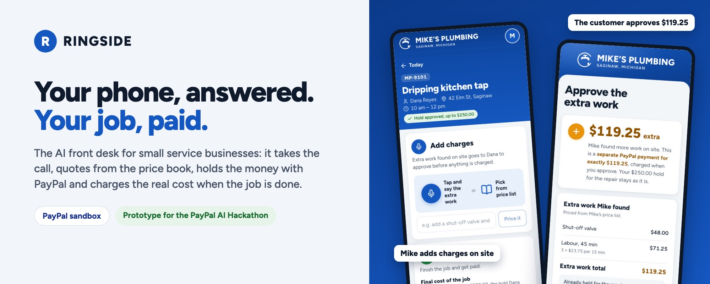
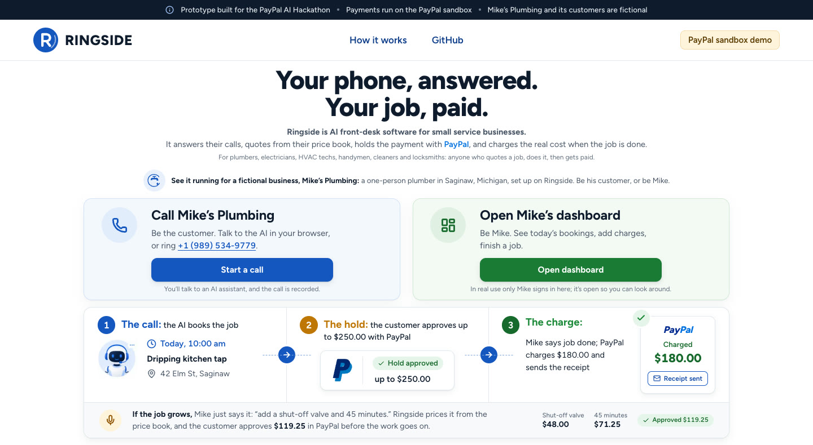
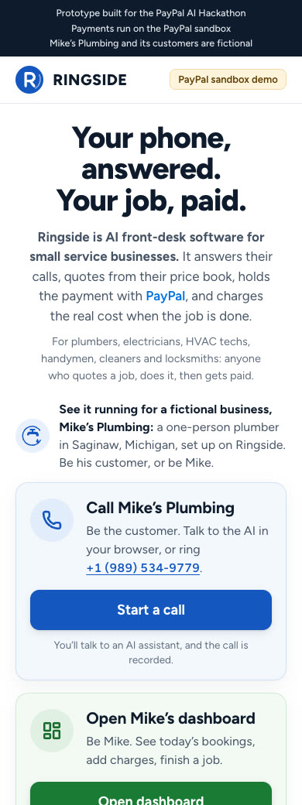
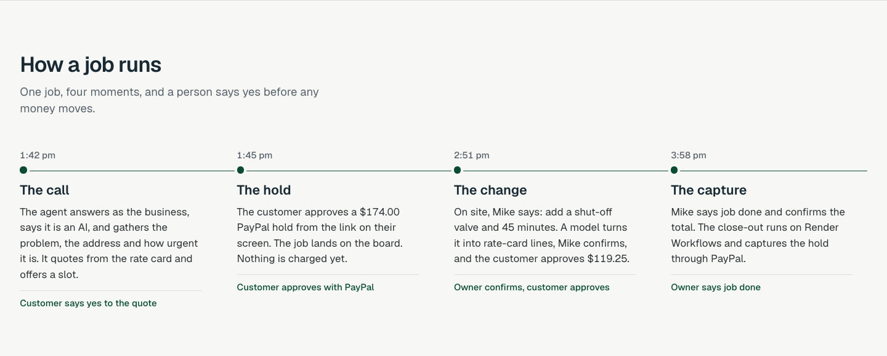
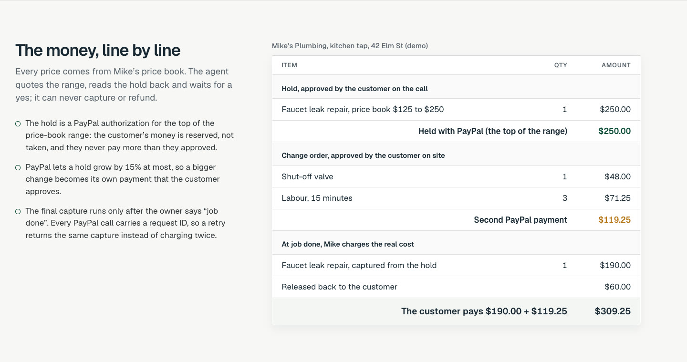

<div align="center">



# Ringside

[](https://paypalaihackathon.devpost.com)
[](https://paypalaihackathon.devpost.com/details/dates)
[](#status-and-limits)
[](LICENSE)

<table align="center">
  <tr>
    <td align="center" width="170">
      <br>
      <b>PayPal</b><br>
      <sub>The money. Holds the payment at booking, takes a second payment for the change order, captures at job done.</sub>
    </td>
    <td align="center" width="170">
      <br>
      <b>ElevenLabs</b><br>
      <sub>The voice. Answers the phone and the browser call, gathers the job and quotes it.</sub>
    </td>
    <td align="center" width="170">
      <br>
      <b>Twilio</b><br>
      <sub>The phone line. The business's US number, connected straight to the agent.</sub>
    </td>
    <td align="center" width="170">
      <br>
      <b>Render</b><br>
      <sub>The platform. Runs the app, its Postgres, and the close-out on Render Workflows.</sub>
    </td>
    <td align="center" width="170">
      <br>
      <b>Claude</b><br>
      <sub>The change orders. Claude Sonnet 5.5 turns the owner's spoken extra work into rate-card lines.</sub>
    </td>
  </tr>
</table>


</div>

Ringside is the AI front desk for small service businesses: the plumber, electrician, HVAC tech, cleaner or locksmith
who is the business, the dispatcher and the cashier at once. It answers the call while they are on a job, quotes from
their own price book, holds the customer's money with PayPal, gets the customer's yes when the job grows on site, and
captures the final amount when the work is done. The demo business is Mike's Plumbing, which is fictional. Ringside is
a prototype built for the PayPal AI Hackathon and runs on the PayPal sandbox.

## How it works

1. **The call.** A customer in Mike's area (the Saginaw Tri-Cities, Michigan) phones the business or calls from the
   browser. The ElevenLabs agent says it is an AI assistant answering for Mike, finds the job in Mike's price book and
   quotes its range: a dripping faucet is $125 to $250. It offers a slot.
2. **The hold.** After reading the amount back and hearing a yes, the agent creates a PayPal hold (Orders v2,
   `intent: AUTHORIZE`) for the top of the range, $250.00. On a phone call it asks for an email, spells it back letter
   by letter and sends the link only after the caller confirms; in the browser the link appears on screen. The customer
   approves the hold with PayPal's button; nothing is charged yet. Major jobs get an estimate visit instead, with no
   payment.
3. **The change order.** On site, Mike says "add a shut-off valve and 45 more minutes". It becomes rate-card lines
   ($119.25), Mike confirms, and the customer approves it as a second PayPal payment. PayPal lets a hold grow by 15% at
   most, so a bigger change is its own payment.
4. **The capture.** Mike says "job done" and enters the real cost, say $190.00. The close-out captures that much from
   the hold, releases the rest, and sends a PayPal invoice: marked paid as a receipt, or payable for any leftover
   balance.

Nobody pays without saying yes, nobody pays more than they approved, and every price comes from the price book, checked in code.



| On a phone | How a job runs |
|---|---|
|  |  |



## Real runs

Measured against the real PayPal sandbox and the real phone line on 2026-11-05.

| What | Result | How |
|---|---|---|
| Place a PayPal hold | $174.00 authorized in 1.8–2.0 s; the hold lasts 29 days | `scripts/sandbox/auth-gates.mjs` |
| Capture a hold | 1.5–2.6 s | same |
| Capture more than the hold | 115% allowed ($200.10 on $174.00); +$75 and +69% refused with `MAX_CAPTURE_AMOUNT_EXCEEDED` | same |
| Retry a final capture with the same `PayPal-Request-Id` | PayPal returns the original capture; nothing is charged twice | same |
| Release the rest of a hold | a capture of part, then a void, leaves exactly the part captured | same |
| Second payment for a change order | $119.25 captured in 1.6 s | same |
| A real phone call to the agent | answered with the AI disclosure; replies 0.5–0.65 s after the caller stops (1.3 s at most) over 99 s | a live call to the Twilio number |

## The tech, part by part

| Part | Built with | What it does |
|---|---|---|
| Phone line | Twilio US number, imported into ElevenLabs | Callers dial the business and land straight on the agent ([`scripts/gates/setup-voice.mjs`](scripts/gates/setup-voice.mjs)) |
| Voice agent | ElevenLabs Agents; LLM `gpt-5-nano` with minimal reasoning (hosted by ElevenLabs), calls capped at 6 minutes; voice "Chris" on `eleven_v4_turbo` | Answers as Mike's AI assistant and gathers the job; its server tools read the rate card, find open windows, save the quote, book it and send the PayPal hold link only after the customer says yes ([`src/lib/agent-tools.ts`](src/lib/agent-tools.ts), [`src/lib/slots.ts`](src/lib/slots.ts)) |
| Prices | Mike's price book (about 140 jobs as USD ranges) and fixed-price add-ons for change orders, money in integer cents | Every quote comes from the book and holds the top of its range; add-ons are parts and labour in 15-minute blocks of $23.75 ([`src/lib/price-book.ts`](src/lib/price-book.ts), [`src/lib/rate-card.ts`](src/lib/rate-card.ts)) |
| Service area | The Saginaw Tri-Cities by ZIP and city | Callers outside it get no booking and no payment ([`src/lib/service-area.ts`](src/lib/service-area.ts)) |
| Payments | PayPal Orders v2 (`AUTHORIZE`, `CAPTURE`), Payments v2 (capture, void), Webhooks | The hold, the change order's second payment, the capture; every POST carries a stored `PayPal-Request-Id` ([`src/lib/paypal.ts`](src/lib/paypal.ts)) |
| Approval page | Next.js page with PayPal's JavaScript SDK buttons | The customer approves the hold; the server authorizes it and books the job, safely repeatable ([`src/app/j/[code]/page.tsx`](src/app/j/[code]/page.tsx), [`src/lib/holds.ts`](src/lib/holds.ts)) |
| Link by email | Resend | After a phone call, the link goes to the email the caller confirmed letter by letter; the address is not stored ([`src/lib/email.ts`](src/lib/email.ts)) |
| Agent setup | ElevenLabs API: webhook tools and a workspace secret | Puts the ten tools and the prompt on the agent; re-runnable ([`scripts/agent/configure.mjs`](scripts/agent/configure.mjs)) |
| Invoices | PayPal Invoicing v2 (being built) | The receipt at job done, or a payable invoice for a leftover balance |
| Change-order parser | Claude Sonnet 5.5 (`claude-sonnet-5-5`, Anthropic API) with structured output (being built) | Turns Mike's spoken change into rate-card lines; the code rejects anything not on the card |
| Close-out | Render Workflows flow (being built) | Capture, invoice, close; a replay after a failure reuses PayPal's original response |
| Jobs and state | Postgres 18; a job state machine | Jobs, calls, line items, payments and events, each scoped to a demo session ([`db/migrations/`](db/migrations/001_init.sql), [`src/lib/job-state.ts`](src/lib/job-state.ts)) |
| App | Next.js 16 (App Router), React 19, TypeScript 5.9, Geist, lucide-react | The landing page now; the call page, the customer's approval page and the owner's screens next ([`src/app/`](src/app/page.tsx)) |
| Owner dashboard | Installable PWA, phone first; Mike's Books on desktop in AG Studio with its agent framework (being built) | Today's jobs with Add charges and Job done, every call with its cost and outcome, each job's money, and "Ask your books" |
| Hosting | Render web service and Render Postgres from one Blueprint | Always on; migrations run before every deploy ([`render.yaml`](render.yaml), [`scripts/migrate.mjs`](scripts/migrate.mjs)) |
| Checks | Vitest, ESLint, GitHub Actions with a Postgres 18 service | 62 tests, including the PayPal client against recorded sandbox responses ([`test/`](test/paypal.test.ts)) |

PayPal runs in the sandbox only: the server refuses to start unless `PAYPAL_ENV=sandbox`.

## Run it yourself

You need Node 24, Docker (for a local Postgres), a PayPal developer account with a sandbox app on a US business
account, and, for the voice parts, an ElevenLabs account and a Twilio number.

```bash
git clone https://github.com/padmanabhan-r/Ringside && cd Ringside
npm ci
cp .env.example .env          # fill in the values below
docker run -d --name ringside-pg -e POSTGRES_PASSWORD=postgres -e POSTGRES_DB=ringside \
  -p 127.0.0.1:5432:5432 postgres:18
node --env-file=.env scripts/migrate.mjs
npm run dev                   # http://localhost:3000
```

| Variable | For |
|---|---|
| `PAYPAL_ENV` | Must be `sandbox`; the app refuses to start otherwise |
| `PAYPAL_CLIENT_ID`, `PAYPAL_CLIENT_SECRET` | The PayPal sandbox app's credentials |
| `PAYPAL_WEBHOOK_ID` | Verifying PayPal webhook deliveries |
| `CHANGE_ORDER_MODE` | `second_order` (default): a change is its own PayPal payment |
| `DATABASE_URL` | Postgres |
| `ELEVENLABS_API_KEY`, `ELEVENLABS_AGENT_ID` | The voice agent |
| `ELEVENLABS_TOOL_SECRET`, `ELEVENLABS_WEBHOOK_SECRET` | Authenticating the agent's tool calls and post-call webhooks |
| `TWILIO_PHONE_NUMBER`, `TWILIO_ACCOUNT_SID`, `TWILIO_API_KEY_SID`, `TWILIO_API_KEY_SECRET` | The phone line |
| `TWILIO_AUTH_TOKEN` | Only for importing the number into ElevenLabs (optional afterwards) |
| `TWILIO_TEST_CALLER_ID` | Only for the scripted test call (optional) |
| `RESEND_API_KEY`, `EMAIL_FROM` | Emailing the PayPal link to phone callers (optional: without them the agent reads out the job code) |
| `LLM_API_KEY`, `LLM_MODEL` | The change-order parser |
| `DAILY_VOICE_MINUTES_CAP`, `SESSION_LLM_CALLS_CAP` | Cost caps for the public demo |
| `APP_BASE_URL` | Links the agent hands out |
| `RENDER_API_KEY` | Local deploy and log checks only (optional) |

Every value stays on the server; only `PAYPAL_CLIENT_ID` reaches a browser. [`.env.example`](.env.example) says where
each one comes from.

## Status and limits

Working today: the landing page on Render with its Postgres, the PayPal sandbox flow (hold, change payment, capture,
void, idempotent retries) through the PayPal client, the phone line answered by the voice agent, which quotes from the
price book and creates the PayPal hold, and the approval page where the customer places it.

- PayPal runs in the sandbox only, in USD.
- A hold can grow by at most 15% at capture, so a larger change order is always a separate payment.
- After a phone call, the demo emails the PayPal link (or the caller types a short job code). A business registered for US
  text messaging (A2P 10DLC) can text the link instead.

## Next steps

- **The browser call page:** the same agent in the browser, with the live job card and the link on screen.
- **The change order on the approval page:** approve the extra with PayPal's buttons.
- **Mike's app:** an installable PWA for his phone: today's jobs, speak the change order, confirm the lines, say job done, and a notification when a booking or a hold comes in.
- **Mike's Books:** an AG Studio dashboard of jobs, payments and calls on the desktop, with an "Ask your books" agent.
- **PayPal's official server SDK** for the order and payment calls.
- **The close-out on Render Workflows:** capture, invoice and close, safe to replay.
- **The demo video and the public demo,** usable through the end of judging.

## Repository

| Path | What it is |
|---|---|
| [`src/app/`](src/app/page.tsx) | The Next.js app; the landing page is `page.tsx` |
| [`src/lib/`](src/lib/paypal.ts) | PayPal client, rate card, cents math, job state machine, database access |
| [`db/migrations/`](db/migrations/001_init.sql) | The Postgres schema, applied on every deploy |
| [`scripts/sandbox/`](scripts/sandbox/auth-gates.mjs) | PayPal sandbox checks: token, holds, partial and over-captures, replays |
| [`scripts/agent/`](scripts/agent/configure.mjs) | The voice agent's tools and prompt, applied through the ElevenLabs API |
| [`scripts/gates/`](scripts/gates/setup-voice.mjs) | Phone line checks: Twilio settings, voice agent setup, a scripted test call |
| [`scripts/capture.mjs`](scripts/capture.mjs) | Full-page screenshots at real device widths |
| [`test/`](test/paypal.test.ts) | Unit tests, with recorded PayPal sandbox responses in `test/fixtures/` |
| [`render.yaml`](render.yaml) | The Render Blueprint: web service and database |
| [`PRODUCT.md`](PRODUCT.md) | Who Ringside is for and the rules the design follows |
| [`devlog.md`](devlog.md) | Build log |
| [`assets/`](assets/src/banner.html) | README images; the banner's HTML source is in `assets/src/` |

```bash
npm run check    # typecheck, lint, tests, docs check
npm run build
```

## License

[MIT](LICENSE)
