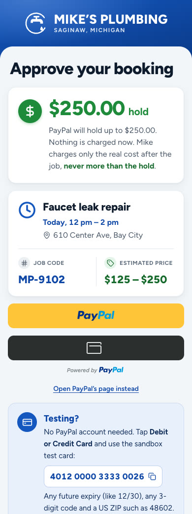
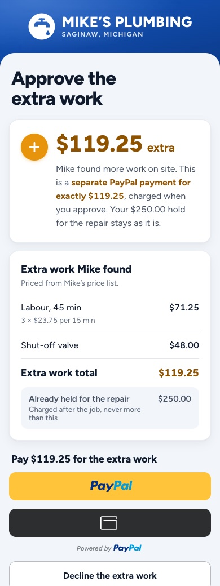
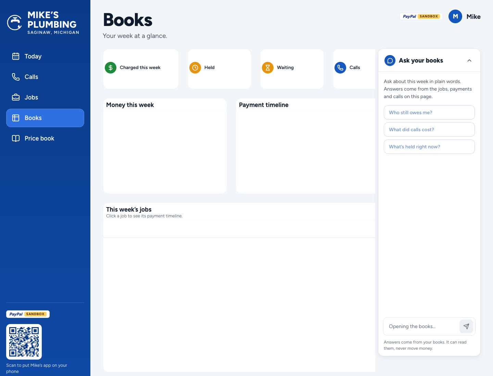

<div align="center">


# Ringside

[](https://ringside-4bup.onrender.com)
[](https://ringside-4bup.onrender.com/call)
[](https://ringside-4bup.onrender.com/dashboard)

[](https://paypalaihackathon.devpost.com)
[](https://paypalaihackathon.devpost.com/details/dates)
[](#status-and-limits)
[](#status-and-limits)
[](LICENSE)

<table align="center">
  <tr>
    <td align="center" width="145">
      <br>
      <b>PayPal</b><br>
      <sub>The money. A hold at booking, a second payment for extra work, the real cost captured at job done, an invoice as the receipt.</sub>
    </td>
    <td align="center" width="145">
      <br>
      <b>ElevenLabs</b><br>
      <sub>The voice. Answers the phone and the browser call, quotes from the price book and sends the PayPal link.</sub>
    </td>
    <td align="center" width="145">
      <br>
      <b>Twilio</b><br>
      <sub>The phone line. The business's US number, connected straight to the agent.</sub>
    </td>
    <td align="center" width="145">
      <br>
      <b>Render</b><br>
      <sub>The platform. Runs the app and its Postgres, and the job close-out on Render Workflows.</sub>
    </td>
    <td align="center" width="145">
      <br>
      <b>Claude</b><br>
      <sub>The change orders. Turns what Mike says on site into priced lines from his rate card.</sub>
    </td>
    <td align="center" width="145">
      <br>
      <b>AG Grid</b><br>
      <sub>The books. Mike's week of jobs, payments and calls in AG Studio, with an "Ask your books" agent.</sub>
    </td>
  </tr>
</table>


</div>

**Ringside is call-to-cash for small service businesses: it turns a phone call into a paid job.** It is built for the
plumber, electrician, HVAC tech, cleaner or locksmith who is the business, the dispatcher and the cashier at once. A
business signs up and gets its own AI phone agent, its price book, PayPal payments and a dashboard on its phone. Ringside
answers the business's calls while the owner is on a job, quotes from the price book, holds the customer's money with
PayPal before the visit, gets the customer's yes when the job grows on site, and charges the real cost when the work is
done.

**The demo runs one example business on Ringside: Mike's Plumbing**, a fictional one-person plumber in Saginaw,
Michigan. Its customers, jobs and calls are fictional too. Ringside is a prototype built for the PayPal AI Hackathon and
runs on the PayPal sandbox.


**For the judges:** open the [live demo](https://ringside-4bup.onrender.com) and try Ringside as the demo business's
customer: call Mike's Plumbing in the browser or on **[+1 (989) 534-9779](tel:+19895349779)**, then approve the hold with
PayPal's sandbox test card `4012 0000 3333 0026` (any future expiry and code; no PayPal account needed). Then open the
owner's dashboard to add charges and finish the job. No mic? **Book without calling** on the call page runs the same quote and PayPal hold from a short form, and a recorded call shows the conversation.

## How it's different

AI phone agents for trades are everywhere now, typically $99 to $299 a month[^price], and they stop at the booking.
Field-service suites take payments, as office paperwork after the job. Ringside carries the call all the way to the
payment.

| | Most AI phone agents for trades | Field-service suites | Ringside |
|---|---|---|---|
| Answers the call around the clock | Yes | As an add-on | Yes |
| Quotes a price on the call, from the business's own price book | Usually not | No | Yes, a range, read back to the caller |
| Secures the payment before the visit | No | Usually not | Yes, a PayPal hold for the top of the range |
| Extra work found on site, approved and paid before work goes on | No | A change order, usually billed later | Yes: the owner says it, the customer approves it in PayPal |
| Charges the real cost, never more than the customer approved | No | An invoice after the job | Yes, captured from the hold; the rest is released |
| Receipt | No | Yes | Yes, a PayPal invoice marked paid |

[^price]: Typical small-business pricing from [The AI Savvy's 2026 overview](https://theaisavvy.com/blog/ai-receptionist-for-plumbers-and-hvac-companies/california/san-diego); a few start lower with call limits.

## How it works

Every business on Ringside runs the same flow; the screens below are the demo business, Mike's Plumbing.

1. **The call.** A customer in Mike's area (the Saginaw Tri-Cities, Michigan) phones the business or calls from the
   browser. The ElevenLabs agent says it is an AI assistant answering for Mike, finds the job in Mike's price book,
   quotes its range (a dripping faucet is $125 to $250) and offers a visit window. Calls end at six minutes, and the
   agent says goodbye before that.


2. **The hold.** After reading the amount back and hearing a yes, the agent creates a PayPal hold (Orders v2,
   `intent: AUTHORIZE`) for the top of the range, $250.00. In the browser the link appears on screen; on a phone call
   the agent spells the caller's email back letter by letter and sends the link only after a yes. The customer approves
   with PayPal's buttons, or as a guest with a card. Nothing is charged yet. The job lands on Mike's phone.

<div align="center">
<table>
  <tr>
    <td align="center" width="50%">
      <br>
      <sub><b>The customer approves the hold</b></sub>
    </td>
    <td align="center" width="50%">
      <br>
      <sub><b>Mike's day, job he's on first</b></sub>
    </td>
  </tr>
</table>
</div>

3. **The change order.** On site, Mike taps the mic and says "add a shut-off valve and 45 more minutes" (or types it,
   or picks from his price list). Claude turns it into rate-card lines; the code prices them from the card: $48.00 plus
   three 15-minute blocks of $23.75, $119.25. Mike checks the lines and sends them, and the customer approves a second
   PayPal payment for exactly that amount, from the same page as the booking or a QR code on Mike's phone. PayPal lets a
   hold grow by 15% at most, so extra work is always its own payment.

<div align="center">
<table>
  <tr>
    <td align="center" width="50%">
      <br>
      <sub><b>Mike adds charges</b></sub>
    </td>
    <td align="center" width="50%">
      <br>
      <sub><b>The customer approves the extra</b></sub>
    </td>
  </tr>
</table>
</div>

4. **Job done.** Mike enters the real cost, inside the quoted range and never above the hold, and confirms it with a
   second tap. PayPal captures exactly that and releases the rest. The close-out then sends a PayPal invoice, marked
   paid, as the customer's receipt, and closes the job. It runs on Render Workflows and is safe to replay.
5. **Mike's desk.** On a laptop the same dashboard shows the day's bookings, what is held, waiting and paid this week,
   and every call with its cost, plus **Mike's Books**: his week in AG Studio, with an agent that answers questions like
   "Who still owes me?" from his own data. Mike installs the dashboard on his phone as an app: one tap where the browser
   offers it, a Share hint on iPhone, or a QR code from the desk.




Nobody pays without saying yes, nobody pays more than they approved, and every price comes from the price book, checked
in code.

## Real runs

Measured against the real PayPal sandbox, the phone line and the Anthropic API on 2026-11-05. Nothing here is scripted.

| What | Result | How |
|---|---|---|
| Place a PayPal hold | $174.00 authorized in 1.8–2.0 s; the hold lasts 29 days | `scripts/sandbox/auth-gates.mjs` |
| Capture a hold | 1.5–2.6 s | same |
| Capture more than the hold | 115% allowed ($200.10 on $174.00); +$75 and +69% refused with `MAX_CAPTURE_AMOUNT_EXCEEDED` | same |
| Retry a final capture with the same `PayPal-Request-Id` | PayPal returns the original capture; nothing is charged twice | same |
| Second payment for a change order | $119.25 captured in 1.6 s | same |
| Orders through the PayPal server SDK | create and get for both intents; a replayed create with the same request ID returns the same order, a new ID a new one; authorize or capture before approval gives `ORDER_NOT_APPROVED` (13 checks) | `scripts/sandbox/sdk-orders.ts` |
| Ask the books | "Who still owes me?" → "Luis in Bay City hasn't approved the $225.00 hold for the running toilet. Everything else is paid or secured" | Mike's Books on the dev server |
| Turn speech into change-order lines | "a shut-off valve and 45 more minutes" → valve + 3 × 15 min = $119.25; a water softener (not on the card) reported, not priced; 3.2–4.7 s, under a cent a call | `scripts/sandbox/change-order-parser.rec.ts` |
| Send the receipt invoice | created, sent and marked paid in 5.9 s; a replay made one GET and sent nothing twice | `scripts/sandbox/receipt-flow.ts` |
| A real phone call to the agent | answered with the AI disclosure; replies 0.5–0.65 s after the caller stops (1.3 s at most) over 99 s, on the first test agent's model | a live call to the Twilio number |

## The tech, part by part

| Part | Built with | What it does |
|---|---|---|
| Phone line | Twilio US number, imported into ElevenLabs | Callers dial the business and land straight on the agent ([`scripts/gates/setup-voice.mjs`](scripts/gates/setup-voice.mjs)) |
| Voice agent | ElevenLabs Agents; LLM `gpt-6-luna` with low reasoning, hosted by ElevenLabs; voice "Chris"; calls capped at 6 minutes | Answers as Mike's AI assistant; its ten server tools read the price book, check the service area, find open windows, save the quote, book it and send the PayPal link only after a yes. Near the time limit every tool reply tells it to wrap up ([`src/lib/agent-tools.ts`](src/lib/agent-tools.ts), [`scripts/agent/configure.mjs`](scripts/agent/configure.mjs)) |
| Browser call | `@elevenlabs/react` over WebRTC, a server-issued conversation token | The same agent in the browser with a live transcript and a booking card that fills in; the conversation is registered to the visitor's session before the first tool call; a recorded call, and **Book without calling**: a short form with the same read-back that runs the agent's own quote, booking and hold tools ([`src/app/call/`](src/app/call/page.tsx)) |
| Prices | Mike's price book (125 jobs as USD ranges) and a rate card of add-ons, money in integer cents | A quote holds the top of its range; extra work is parts and labour in 15-minute blocks of $23.75 ([`src/lib/price-book.ts`](src/lib/price-book.ts), [`src/lib/rate-card.ts`](src/lib/rate-card.ts)) |
| Service area | The Saginaw Tri-Cities by ZIP and city | Callers outside it get no booking and no payment ([`src/lib/service-area.ts`](src/lib/service-area.ts)) |
| Payments | PayPal Orders v2 (`AUTHORIZE`, `CAPTURE`) and Payments v2 (capture, void), through the server SDK | The hold, the change order's second payment, the final capture; every POST carries a stored `PayPal-Request-Id` ([`src/lib/paypal.ts`](src/lib/paypal.ts), [`src/lib/holds.ts`](src/lib/holds.ts), [`src/lib/change-orders.ts`](src/lib/change-orders.ts), [`src/lib/job-done.ts`](src/lib/job-done.ts)) |
| Customer page | Next.js page with PayPal's JavaScript SDK buttons and guest card checkout | Approve the hold, approve or decline extra work, see the charge and receipt ([`src/app/j/[code]/page.tsx`](src/app/j/[code]/page.tsx)) |
| Change-order parser | Claude Sonnet 5.5 (`claude-sonnet-5-5`, Anthropic API), structured output with a strict JSON schema | Names rate-card items and quantities only; the code takes every price from the card and rejects unknown items, prices from the model and quantities past the card's limits ([`src/lib/change-order-parser.ts`](src/lib/change-order-parser.ts)) |
| Mike's app | Next.js, installable PWA, the browser's speech recognition | Today with the job he's on first, the job screen with Add charges, Job done and Cancel job (which voids the PayPal hold and releases the money), a QR code for on-site approval, find a phone booking by its job code ([`src/app/dashboard/`](src/app/dashboard/page.tsx)) |
| Receipts | PayPal Invoicing v2 | After the capture, an invoice for the job and any extra work, recorded as paid: emailed when PayPal has the payer's email, otherwise a link. Repeat-safe through the invoice's own state ([`src/lib/receipts.ts`](src/lib/receipts.ts)) |
| Close-out | Render Workflows (`@renderinc/sdk`) | Receipt, then close the job; retried by Render, every step idempotent; runs inline when no workflow key is set ([`workflows/close-out.ts`](workflows/close-out.ts), [`src/lib/close-out.ts`](src/lib/close-out.ts)) |
| Webhooks | PayPal Webhooks, signature verified | An approval completes even if the customer closes the page; captures, voids and paid invoices are recorded ([`src/app/api/paypal/webhook/route.ts`](src/app/api/paypal/webhook/route.ts)) |
| Link by email | Resend | After a phone call, the link goes to the email the caller confirmed letter by letter; the address is not stored ([`src/lib/email.ts`](src/lib/email.ts)) |
| Mike's Books | AG Studio 3.0 (AG Grid 36.2, AG Charts 14.2) in view mode, themed from the app's tokens; the Studio Agent Framework with Claude Haiku 5.5 through a server proxy | Mike's week on the desk: custom figure-tile and payment-timeline widgets, money by day, the jobs grid with status pills, and "Ask your books", which reads the books through a `read_books` tool and can point the timeline at a job; capped per request, visit and day ([`src/app/dashboard/books/`](src/app/dashboard/books/page.tsx), [`src/app/api/books/ai/route.ts`](src/app/api/books/ai/route.ts)) |
| PayPal server SDK | `@paypal/paypal-server-sdk` 2.5, generated by APIMatic; written with APIMatic's PayPal context plugin | Orders and Payments run through PayPal's official SDK with the stored request IDs; Invoicing and webhook checks stay on REST, which the SDK doesn't cover ([`src/lib/paypal.ts`](src/lib/paypal.ts)) |
| Demo sessions | A cookie per visitor; Postgres 18; a job state machine | Each visitor sees only their own jobs plus labelled sample jobs that can't be charged ([`src/lib/dashboard.ts`](src/lib/dashboard.ts), [`src/lib/job-state.ts`](src/lib/job-state.ts), [`db/migrations/`](db/migrations/001_init.sql)) |
| App | Next.js 16 (App Router), React 19, TypeScript 5.9, Figtree, lucide-react | Landing page, call page, customer page, Mike's app ([`src/app/`](src/app/page.tsx)) |
| Hosting | Render web service, Render Postgres and a Render workflow from one Blueprint | Always on; migrations run before every deploy ([`render.yaml`](render.yaml), [`scripts/migrate.mjs`](scripts/migrate.mjs)) |
| Checks | Vitest, ESLint, GitHub Actions with a Postgres 18 service | 131 tests, including the PayPal client and the parser against recorded real responses ([`test/`](test/paypal.test.ts)) |

PayPal runs in the sandbox only: the server refuses to start unless `PAYPAL_ENV=sandbox`.

## Run it yourself

You need Node 24, Docker (for a local Postgres), a PayPal developer account with a sandbox app on a US business
account, an Anthropic API key for the change-order parser, and, for the voice parts, an ElevenLabs account and a Twilio
number.

```bash
git clone https://github.com/padmanabhan-r/Ringside && cd Ringside
npm ci
cp .env.example .env          # fill in the values below
docker run -d --name ringside-pg -e POSTGRES_PASSWORD=postgres -e POSTGRES_DB=ringside \
  -p 127.0.0.1:5432:5432 postgres:18
node --env-file=.env scripts/migrate.mjs
node --env-file=.env scripts/agent/configure.mjs     # tools and prompt on your ElevenLabs agent
node --env-file=.env scripts/paypal/create-webhook.mjs   # prints PAYPAL_WEBHOOK_ID
npm run dev                   # http://localhost:3000
```

| Variable | For |
|---|---|
| `PAYPAL_ENV` | Must be `sandbox`; the app refuses to start otherwise |
| `PAYPAL_CLIENT_ID`, `PAYPAL_CLIENT_SECRET` | The PayPal sandbox app's credentials |
| `PAYPAL_WEBHOOK_ID` | Verifying PayPal webhook deliveries |
| `DATABASE_URL` | Postgres |
| `APP_BASE_URL` | The public address in links the agent and the app hand out |
| `ELEVENLABS_API_KEY`, `ELEVENLABS_AGENT_ID` | The voice agent and the browser call |
| `ELEVENLABS_TOOL_SECRET` | Authenticating the agent's tool calls |
| `ELEVENLABS_AGENT_LLM` | The agent's model (optional; default `gpt-6-luna`) |
| `TWILIO_PHONE_NUMBER`, `TWILIO_ACCOUNT_SID`, `TWILIO_API_KEY_SID`, `TWILIO_API_KEY_SECRET`, `TWILIO_AUTH_TOKEN` | Importing the phone line into ElevenLabs (setup only) |
| `LLM_API_KEY`, `LLM_MODEL` | The change-order parser (Anthropic API key; default `claude-sonnet-5-5`) |
| `RESEND_API_KEY`, `EMAIL_FROM` | Emailing the PayPal link to phone callers (optional: without them the agent reads out the job code) |
| `AG_STUDIO_LICENSE_KEY` | AG Studio's licence (without it, a trial watermark shows) |
| `BOOKS_LLM_MODEL` | Ask your books' model (optional; default `claude-haiku-5-5`) |
| `VAPID_PUBLIC_KEY`, `VAPID_PRIVATE_KEY`, `VAPID_SUBJECT` | Phone notifications for Mike (optional; `scripts/push/vapid.mjs` makes the keys) |
| `RENDER_WORKFLOW`, `RENDER_WORKFLOW_API_KEY` | Running the close-out on Render Workflows (optional: without them it runs in the app) |

Secrets stay on the server. Only public values reach a browser: the PayPal client ID, the AG Studio licence key and the VAPID public key. [`.env.example`](.env.example) says where
each one comes from.

## Status and limits

Working end to end in the sandbox: the phone and browser calls, the quote from the price book, the PayPal hold and its
approval (PayPal or guest card), the spoken change order as a second payment, job done with the final capture, the
receipt invoice and the close-out, Mike's installable app, and Mike's Books with its agent, on the live site.

- PayPal runs in the sandbox only, in USD.
- A hold can grow by at most 15% at capture, so extra work is always a separate payment.
- PayPal Invoicing ignores `PayPal-Request-Id`, so the receipt's repeat safety comes from the invoice's own state.
- After a phone call, the demo emails the PayPal link. A business registered for US text messaging (A2P 10DLC) can text
  it instead.
- The Books chart's value axis shows plain numbers: AG Studio's built-in chart doesn't format it as dollars.
- Speaking the extra work uses the browser's speech recognition; where a browser lacks it, Mike types or picks it.

## Next steps

- **The demo video,** and the public demo kept up through the end of judging.

## Repository

| Path | What it is |
|---|---|
| [`src/app/`](src/app/page.tsx) | The Next.js app: landing page, `call/`, the customer page `j/[code]/`, Mike's app `dashboard/`, and the API routes |
| [`src/lib/`](src/lib/paypal.ts) | PayPal client, holds, change orders, job done, receipts, close-out, price book, rate card, parser, data access |
| [`workflows/`](workflows/close-out.ts) | The close-out task for Render Workflows |
| [`db/migrations/`](db/migrations/001_init.sql) | The Postgres schema, applied on every deploy |
| [`scripts/sandbox/`](scripts/sandbox/auth-gates.mjs) | Checks against the real sandbox and APIs: holds, captures, replays, the parser recordings |
| [`scripts/agent/`](scripts/agent/configure.mjs) | The voice agent's tools, prompt, model and time limit, applied through the ElevenLabs API |
| [`scripts/paypal/`](scripts/paypal/create-webhook.mjs) | Creates the PayPal webhook |
| [`scripts/gates/`](scripts/gates/setup-voice.mjs) | Phone line setup and checks |
| [`scripts/capture.mjs`](scripts/capture.mjs) | Full-page screenshots at real device widths |
| [`test/`](test/paypal.test.ts) | Unit tests, with recorded real responses in `test/fixtures/` |
| [`render.yaml`](render.yaml) | The Render Blueprint: web service, database and workflow |
| [`PRODUCT.md`](PRODUCT.md) | Who Ringside is for and the rules the design follows |
| [`devlog.md`](devlog.md) | Build log |
| [`assets/`](assets/src/banner.html) | README images; the banner's HTML source is in `assets/src/` |

```bash
npm run check    # typecheck, lint, tests, docs check
npm run build
```

## License

[MIT](LICENSE)
