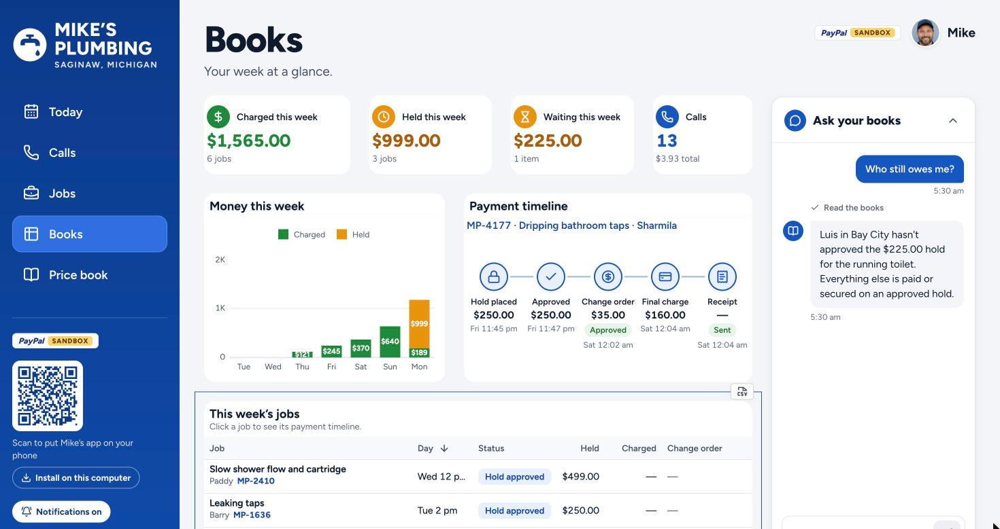
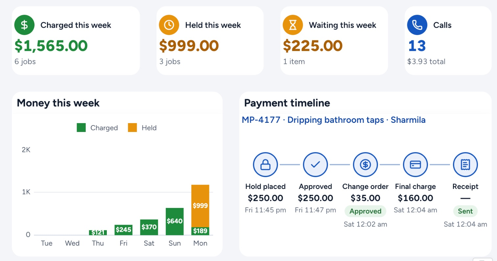
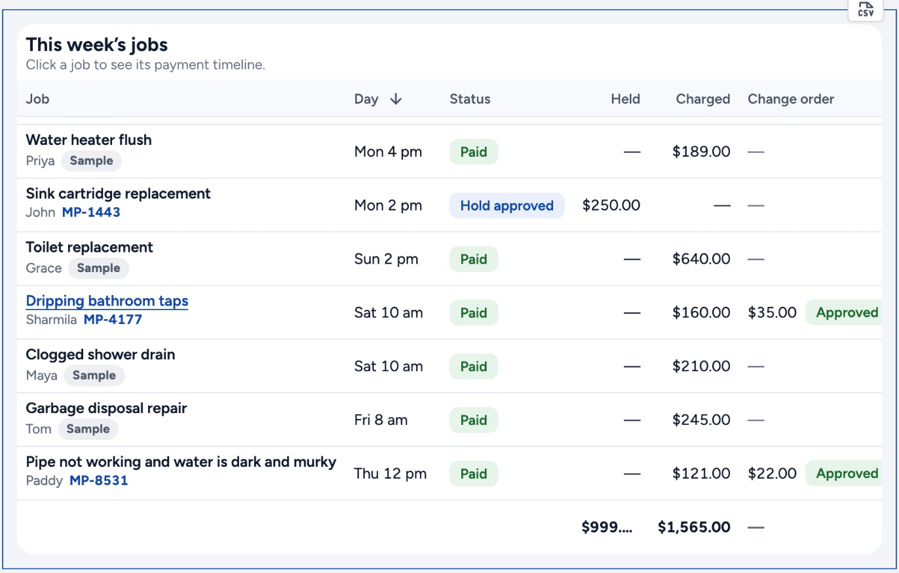
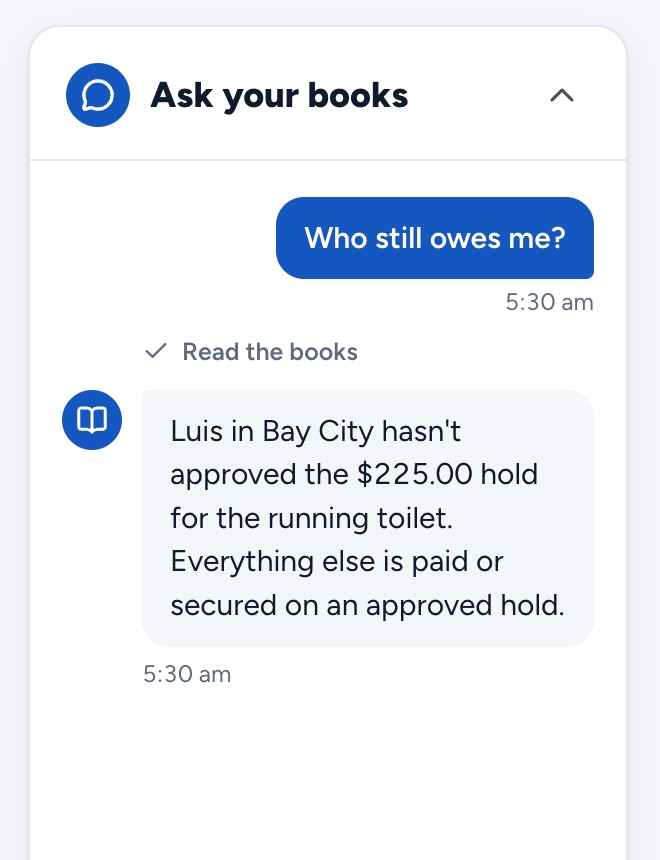

# AG Grid in Ringside

[← Back to the README](../README.md#sponsor-tools-ag-grid-apimatic-and-render) · Sponsor pages:
[PayPal](paypal.md) · **AG Grid** · [APIMatic](apimatic.md) · [Render](render.md)

**Mike's Books** is the owner's week of money in one place: what was charged, what PayPal is holding, what customers
still have to approve, and what the phone line cost. It is one **AG Studio 3.0** dashboard (AG Grid 36.2 and
AG Charts 14.2 underneath), themed to look like the rest of Ringside, with two custom widgets and an **"Ask your books"**
agent built on the **Studio Agent Framework**.

Open it live: **[ringside-4bup.onrender.com/dashboard/books](https://ringside-4bup.onrender.com/dashboard/books)**



| What a judge can see | How it's built | Code |
|---|---|---|
| Figure tiles: charged, held, waiting, calls | **Custom widget** `figure`, registered with `createWidgets`, reading its data through `widgetApi.getData` | [`studio/widgets.tsx`](../src/app/dashboard/books/studio/widgets.tsx) |
| Payment timeline for the selected job | **Custom widget** `payment-timeline`, cross-filtered from the grid | [`studio/widgets.tsx`](../src/app/dashboard/books/studio/widgets.tsx) |
| Money this week | Studio's built-in `column-chart-stacked` (AG Charts) | [`studio/report.ts`](../src/app/dashboard/books/studio/report.ts) |
| This week's jobs | Studio's built-in `grid` (AG Grid) with custom cell renderers for status, job ref, change order and receipt pills | [`studio/widgets.tsx`](../src/app/dashboard/books/studio/widgets.tsx), [`studio/report.ts`](../src/app/dashboard/books/studio/report.ts) |
| One look with the app | `studioTheme.withParams`, every value a CSS variable from the app's own tokens | [`studio/theme.ts`](../src/app/dashboard/books/studio/theme.ts) |
| Layout | A report defined as `AgReportState`: one page, widgets placed on Studio's layout grid | [`studio/report.ts`](../src/app/dashboard/books/studio/report.ts) |
| Ask your books | **Studio Agent Framework**: `createAiHarness`, `directLlmRunner`, two tools, a server-side model adapter | [`studio/ai.ts`](../src/app/dashboard/books/studio/ai.ts), [`api/books/ai`](../src/app/api/books/ai/route.ts) |
| Real data | Postgres rows from real PayPal sandbox jobs, shaped into Studio data sources | [`studio/sources.ts`](../src/app/dashboard/books/studio/sources.ts), [`books/data.ts`](../src/app/dashboard/books/data.ts) |

---

## 1. Custom widgets

AG Studio's built-in widgets cover the chart and the grid. The two things a trades owner most needs to see at a glance
are custom:



- **Figure tiles** (`figure`). Each tile sums or counts one field, with its own label, icon and tone: paid green for
  money charged, amber for money held or waiting. The tiles use Studio's display states (`loading`,
  `incompleteDataMapping`, `displayed`), so an empty week reads as an empty week rather than a broken widget.
- **Payment timeline** (`payment-timeline`). One job's PayPal story as five steps: hold placed, approved, change
  order, final charge, receipt. Each step shows its amount, time and state. Clicking a job in the grid
  **cross-filters** the timeline to that job, and the agent can do the same (below).

Both are registered as additional widget types, each with a typed data mapping, a configuration form, sizes and an
`ai` description so Studio's agent knows what the widget shows. The grid override adds the pill cell renderers:

```ts
// src/app/dashboard/books/studio/widgets.tsx (abridged)
return createWidgets<BooksRegistry>({
  overrides: [{ id: "grid", options: { createCellRenderer: rendererFor } }],
  additionalTypes: [
    {
      id: "figure",
      label: "Figure tile",
      comp: FigureTile,
      dataMapping: {
        key: { type: "field", supportedRoles: ["category"], required: true },
        value: { type: "fieldset", supportedRoles: ["numeric"], required: true },
      },
      ai: { description: "A figure tile: icon, label, a large money total or count, and a caption." },
    },
    {
      id: "payment-timeline",
      label: "Payment timeline",
      comp: PaymentTimeline,
      dataMapping: { steps: { type: "fieldset", supportedRoles: ["category", "numeric", "temporal"], required: true } },
      ai: { description: "One job's payment timeline: hold placed, approved, change order, final charge, receipt." },
    },
  ],
  menu: [...defaults.menu, { label: "Mike's Plumbing", widgetIds: ["figure", "payment-timeline"] }],
});
```

## 2. The jobs grid

Studio's grid widget, fed the week's jobs. Cell renderers turn the raw states into pills: **Hold approved**,
**Waiting**, **Paid**, **Estimate visit**, an approved change order, a sent receipt. The footer row totals what is
held and charged, and the widget's toolbar exports the week to CSV.



## 3. Themed as part of the app

The theme maps Studio onto the dashboard's design tokens, following the token approach in PayPal's AG Studio
boilerplate. Studio draws on the page's own blue-grey ground with white cards, in Figtree and the business's blue,
so it reads as one product. Change a token in `globals.css` and Studio follows.

```ts
// src/app/dashboard/books/studio/theme.ts
export const booksTheme = studioTheme.withParams({
  fontFamily: "var(--font-ui), system-ui, sans-serif",
  textColor: token("text"),
  backgroundColor: token("card"),
  accentColor: token("brand"),
  studioCanvasBackgroundColor: token("bg"),
  // chart series: charged (paid green), held (waiting amber), then the brand blues
  ...palette,
});
```

The dashboard runs in **view mode** (`mode="view"`), because the owner reads his books and doesn't edit the layout.
The layout itself is a report definition in code ([`studio/report.ts`](../src/app/dashboard/books/studio/report.ts)),
so it's versioned with the app.

## 4. "Ask your books" on the Studio Agent Framework



The owner asks plain questions, such as "Who still owes me?", "What did calls cost?" or "What's held right now?",
and gets an answer in one to three sentences, worked out from his own books.

- **Harness**: `createAiHarness` with one `directLlmRunner` agent ("Books"), at most four turns.
- **Tools** defined with `api.defineAiTool`:
  - `read_books` fetches the week from Postgres: every job's held, waiting, charged, change order, receipt and call
    cost.
  - `show_job` points the payment timeline at the job the answer is about, so the dashboard moves with the
    conversation.
- **Model**: Claude Haiku 5.5, through a server proxy ([`api/books/ai`](../src/app/api/books/ai/route.ts)) that
  translates Studio's conversation into the Anthropic Messages API. The system prompt and tool list are fixed on the
  server, so the endpoint can't be used as a general chatbot. Every request is capped in tokens and counted against
  per-visit and daily limits.
- **Read-only**: the agent can read the books but never move money.

The answer in the screenshot is correct for that week: the only money not secured was a $225.00 hold the customer
hadn't approved yet. That is the "Waiting this week" tile.

<br clear="right">

## Why it matters for a one-person business

A plumber doesn't keep a spreadsheet. This page replaces one. Every figure comes from PayPal's own states (an
authorization is "held", a capture is "charged", an unapproved order is "waiting"), so the books can't drift from what
PayPal actually holds. And when he has a question, he can ask it.

---

**Licence note:** AG Studio reads its licence key from `AG_STUDIO_LICENSE_KEY`. Without one a trial watermark shows;
nothing else changes.
