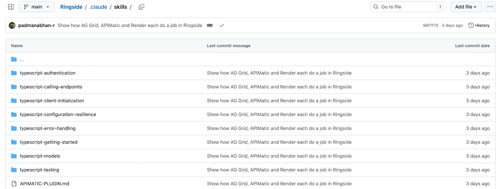
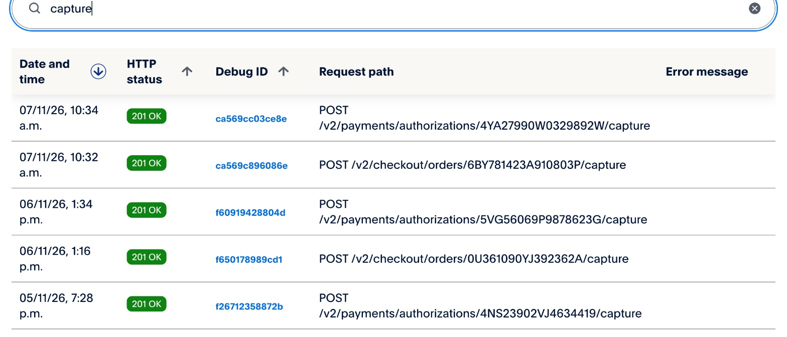

# APIMatic in Ringside

[← Back to the README](../README.md#sponsor-tools-ag-grid-apimatic-and-render) · Sponsor pages:
[PayPal](paypal.md) · [AG Grid](ag-grid.md) · **APIMatic** · [Render](render.md)

Ringside takes its customers' money through **PayPal's server SDK, `@paypal/paypal-server-sdk` 2.5, which APIMatic
generates**. That integration was written with **APIMatic's PayPal context plugin** loaded into the coding agent (Claude
Code), so the agent read how this particular SDK behaves instead of guessing. The plugin's eight TypeScript skills
are checked into this repository.

| | |
|---|---|
| **APIMatic tools used** | The PayPal Server SDK (APIMatic-generated) and APIMatic's [PayPal context plugin](https://github.com/paypaldev/server-sdk-context-plugin-preview) for coding agents |
| **What runs on the SDK** | Orders v2 (create, get, authorize, capture) and Payments v2 (capture an authorization, void), which is every call that places, takes or releases a customer's money |
| **Where** | [`src/lib/paypal.ts`](../src/lib/paypal.ts), with the skills in [`.claude/skills/`](../.claude/skills/APIMATIC-PLUGIN.md) |
| **Tests** | 13 tests replay recorded sandbox responses through the real SDK client: [`test/paypal.test.ts`](../test/paypal.test.ts) |

---

## 1. The context plugin, installed in the repo

```bash
npx context-plugins install https://github.com/paypaldev/server-sdk-context-plugin-preview
```

The plugin's TypeScript skills sit where Claude Code loads them, in `.claude/skills/`. They are committed unchanged
from the plugin's `skills/typescript/` folder at commit `6aa0571` (MIT), with a note on what each one settled:
[`.claude/skills/APIMATIC-PLUGIN.md`](../.claude/skills/APIMATIC-PLUGIN.md).



## 2. What each skill decided in the code

The skills matter most where the SDK's types alone would have led to a wrong choice. Each row is a decision now in
[`src/lib/paypal.ts`](../src/lib/paypal.ts):

| Skill | What it told the agent | What Ringside does |
|---|---|---|
| `typescript-getting-started`, `typescript-client-initialization` | Configuration is one flat options object; controllers are constructed, not read off the client | One `Client`, built once, with `Environment.Sandbox` and a 30 s timeout (the SDK default is none); `new OrdersController(c)` and `new PaymentsController(c)` per call |
| `typescript-authentication` | The credentials property is named after the auth type; a token provider that rejects is cached for good | `oAuthTokenProvider` hands the SDK the app's own cached OAuth token, so the SDK and the REST calls (Invoicing, webhook checks) share one token. It never rejects: on failure it returns an expired token and is asked again |
| `typescript-configuration-resilience` | Two generated fields gate retrying | SDK retries **off** (`maxNumberOfRetries: 0`). Ringside retries itself with the stored `PayPal-Request-Id`, so a retry replays the same request and can't charge twice |
| `typescript-calling-endpoints`, `typescript-models` | An operation takes one options object; request fields are camel-cased; dates are plain strings | `createOrder`, `getOrder`, `authorizeOrder`, `captureOrder`, `captureAuthorizedPayment` and `voidPayment`, each with `paypalRequestId` and `prefer: "return=representation"` |
| `typescript-error-handling` | `result` is undefined on a bare `ApiError`; the error payload keeps the wire names | `ApiError` maps onto `PayPalError { status, issue, debugId }` by reading `debug_id` and `details[].issue`, so a declined card, an unapproved order or an over-capture each get their own answer |
| `typescript-testing` | The seam is a stub adapter passed through `unstable_httpClientOptions`; the SDK ships no mocks | The offline tests serve recorded PayPal responses to the real SDK client through that adapter |

### The client

```ts
// src/lib/paypal.ts
sdkClient ??= new Client({
  environment: Environment.Sandbox,
  timeout: 30_000,
  httpClientOptions: { retryConfig: { maxNumberOfRetries: 0 } },
  clientCredentialsAuthCredentials: {
    oAuthClientId: process.env.PAYPAL_CLIENT_ID ?? "",
    oAuthClientSecret: process.env.PAYPAL_CLIENT_SECRET ?? "",
    // Must never reject: the SDK caches a rejected token for good.
    oAuthTokenProvider: async (): Promise<OAuthToken> => { … },
  },
  ...(fetchOverride ? { unstable_httpClientOptions: { adapter: fetchAdapter(fetchOverride) } } : {}),
});
```

### A money call

```ts
// src/lib/paypal.ts
export async function voidAuthorization(authorizationId: string, requestId: string) {
  const paypalRequestId = requireRequestId(requestId, `/v2/payments/authorizations/${authorizationId}/void`);
  await sdkCall((c) => new PaymentsController(c).voidPayment({ authorizationId, paypalRequestId, prefer: PREFER }));
}
```

`requireRequestId` refuses any POST without a `PayPal-Request-Id` before the SDK is called. `sdkCall` checks for the
sandbox and credentials first, and maps `ApiError` onto `PayPalError`.

## 3. Tested through the SDK, offline

Following `typescript-testing`, the tests don't mock Ringside's PayPal functions. They replace only the HTTP layer
underneath the real SDK client, so the SDK's own serialisation, auth and error parsing are exercised against
responses recorded from the PayPal sandbox:

```ts
// test/paypal.test.ts
it("maps an unapproved order onto PayPalError with PayPal's issue, so holds.ts can answer not_approved", async () => {
  fakePayPal({ "/authorize": fixture("order-not-approved") });
  const err = await authorizeOrder("8NC00352S1876083D", "req-auth-2").catch((e: unknown) => e);
  expect((err as PayPalError).issue).toBe("ORDER_NOT_APPROVED");
  expect((err as PayPalError).status).toBe(422);
});
```

```
$ npx vitest run test/paypal.test.ts
 Test Files  1 passed (1)
      Tests  13 passed (13)
```

The cases cover the $174.00 hold built from rate-card items, the request ID required on every SDK POST, refusal
outside the sandbox, an order whose total doesn't match its items, authorize, capture with a reused cached token,
PayPal's over-capture refusal, void, and a `CAPTURE` order's "Pay Now". No test calls the network.

## 4. In production

The SDK calls are the ones in PayPal's own log for the app. Every `/v2/checkout/orders` and
`/v2/payments/authorizations` call below went through `@paypal/paypal-server-sdk`:



The whole PayPal flow is on the [PayPal page](paypal.md).

## Why it helped

Money code that retries on its own can charge twice, and money code that swallows an error leaves a customer
believing they paid. The plugin flagged both traps in this SDK before they reached the code: SDK retries were turned
off in favour of request-ID replays, and the token provider was made non-rejecting. It also gave the tests a
supported seam, so every PayPal change is checked offline in CI.
