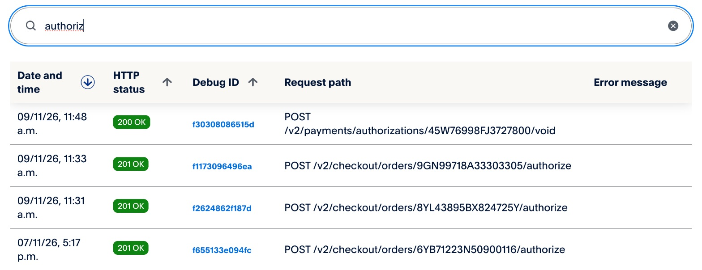
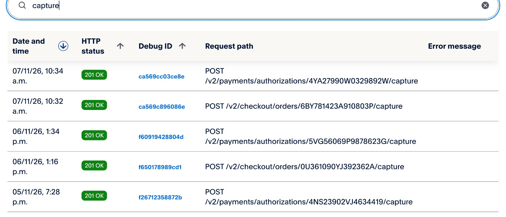
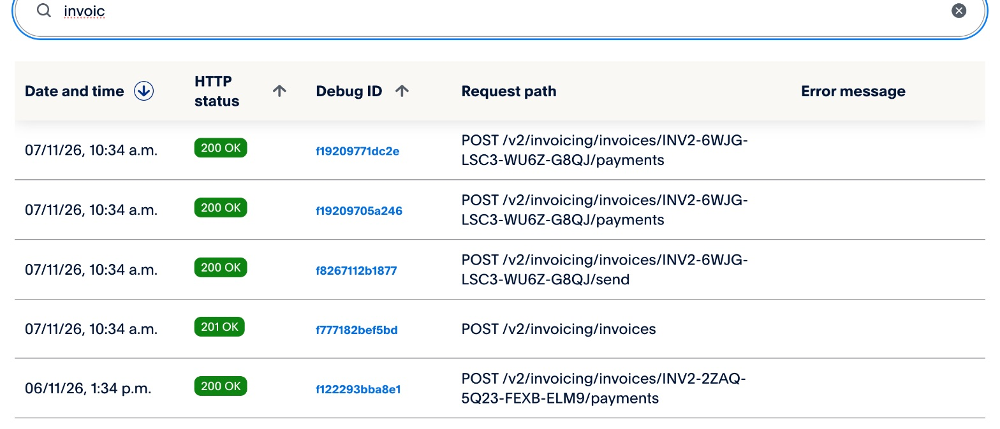
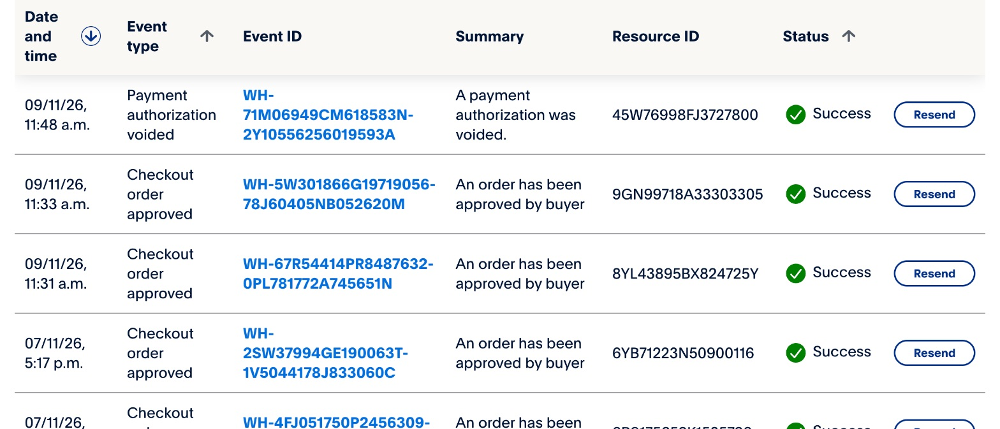
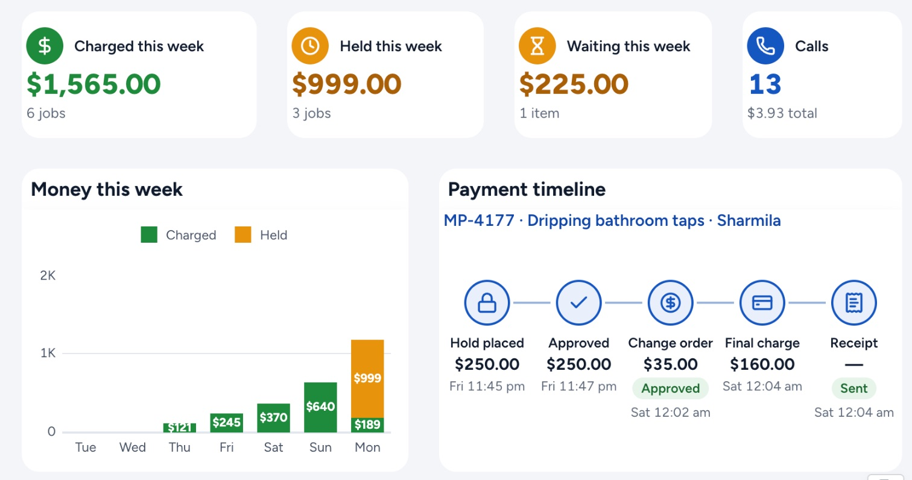
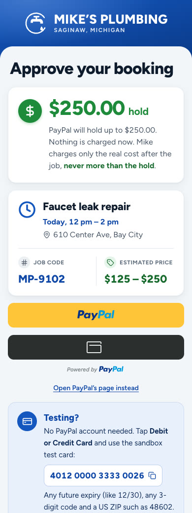
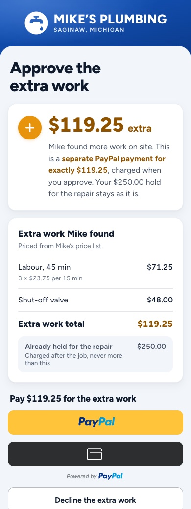

# PayPal in Ringside

[← Back to the README](../README.md#sponsor-tools-ag-grid-apimatic-and-render) · Sponsor pages:
**PayPal** · [AG Grid](ag-grid.md) · [APIMatic](apimatic.md) · [Render](render.md)

PayPal is where the money moves in Ringside. The rest of the app exists to get a customer and the business owner to
each PayPal step with the right amount and a clear yes. One phone call becomes up to three PayPal payments:

| Step | Who acts | PayPal call | What the customer sees |
|---|---|---|---|
| **Hold** for the quote's top price | Customer approves on their phone | Orders v2 `intent: AUTHORIZE`, then `authorize` | "Nothing is charged now, and never more than this" |
| **Extra work** found on site | Customer approves the new amount | A separate Orders v2 `intent: CAPTURE` order, paid on approval | The new items and price, approve or decline |
| **Job done** | Mike (the owner) taps Job done | Payments v2 `capture` of the real cost, `final_capture: true` | The charge, and the rest of the hold released |
| **Receipt** | Runs on its own after the capture | Invoicing v2 create, send, record payment | A PayPal receipt invoice and an email |
| **Cancel** | Mike or the customer | Payments v2 `void` | The hold disappears from their account |

Everything below is from the PayPal **sandbox** (US merchant, US buyer, USD), and every screenshot is from the
project's real sandbox app.

---

## 1. The app's real calls, in PayPal's own logs

The PayPal developer dashboard keeps a log of every API call an app makes. These are Ringside's.

**Holds placed and released.** The voice agent books the job and places the hold, the customer approves it in
PayPal, and the app authorizes the order. Cancelling a booked job voids the authorization, so the customer's money is
released at once rather than after the hold expires:



**The real cost captured.** After the job, the owner's Job done captures the actual cost from the authorization
(`/v2/payments/authorizations/{id}/capture`). Extra work approved on site is its own order, captured when the customer
pays (`/v2/checkout/orders/{id}/capture`):



**The receipt.** The close-out creates a PayPal invoice for exactly what was charged, sends it and records the
payments against it, so the invoice shows as paid. These four calls are job MP-4177's close-out, made from Render
Workflows ([render.md](render.md) shows the same invoice ID in that workflow run's output):



**Webhooks.** PayPal's webhooks reach the app and are checked with `verify-webhook-signature` before anything is
recorded. An approval still completes when the customer closes the page before PayPal's redirect loads:



---

## 2. One job, start to finish

Job **MP-4177** is a real phone call, filmed for the demo video on 2026-11-07:

1. On the phone, the agent quoted a dripping-tap repair from the price book, at $125 to $250, and read the quote back.
   The caller said yes, and the agent sent the PayPal link.
2. The caller approved a **$250.00 hold** while still on the call. The agent confirmed the visit only after its
   `check_hold` tool came back authorized.
3. On site, Mike added **$35.00** of extra work by voice. The customer approved and paid it as its own PayPal payment.
4. At Job done, Mike entered the real cost: **$125.00 was captured** and the other $125.00 of the hold released.
5. The Render workflow created, sent and recorded the PayPal receipt invoice ($160.00 in all) and closed the job.

The same job, as Mike sees it in his books (built on [AG Grid's AG Studio](ag-grid.md)):



And as the customer sees it, on the approval page and on a phone:

<table>
  <tr>
    <td width="50%" align="center">
      <br>
      <sub>The hold: PayPal's buttons load with <code>intent=authorize</code></sub>
    </td>
    <td width="50%" align="center">
      <br>
      <sub>Extra work: its own order, paid on approval (<code>intent=capture</code>)</sub>
    </td>
  </tr>
</table>

---

## 3. How it is built

### Every endpoint

| API | Endpoint | Where |
|---|---|---|
| OAuth | `POST /v1/oauth2/token` (cached, shared by the SDK and REST calls) | [`src/lib/paypal.ts`](../src/lib/paypal.ts) |
| Orders v2 | `POST /v2/checkout/orders`, `GET /v2/checkout/orders/{id}`, `POST …/{id}/authorize`, `POST …/{id}/capture` | [`createOrder`, `getOrder`, `authorizeOrder`, `captureOrder`](../src/lib/paypal.ts#L293-L363) via the server SDK |
| Payments v2 | `POST /v2/payments/authorizations/{id}/capture`, `POST …/{id}/void` | [`captureAuthorization`, `voidAuthorization`](../src/lib/paypal.ts#L365-L385) via the server SDK |
| Invoicing v2 | `POST /v2/invoicing/invoices`, `POST …/search-invoices`, `GET`, `POST …/{id}/send`, `POST …/{id}/payments` | [`src/lib/paypal.ts`](../src/lib/paypal.ts#L460-L520), REST |
| Webhooks | `POST /v1/notifications/verify-webhook-signature`; events `CHECKOUT.ORDER.APPROVED`, `PAYMENT.CAPTURE.COMPLETED` / `PENDING` / `DECLINED`, `PAYMENT.AUTHORIZATION.VOIDED`, `INVOICING.INVOICE.PAID` | [`api/paypal/webhook`](../src/app/api/paypal/webhook/events.ts) |
| JavaScript SDK | PayPal buttons, one script per intent (`authorize` for the hold, `capture` with `commit=true` for extra work) | [`paypal-approval.tsx`](../src/app/j/[code]/paypal-approval.tsx) |

Orders and Payments run through PayPal's official server SDK, `@paypal/paypal-server-sdk` 2.5, which APIMatic
generates ([apimatic.md](apimatic.md)). Invoicing and webhook verification aren't in the SDK, so they stay on REST.

### The hold is an authorization, not a charge

The quote becomes an `AUTHORIZE` order whose items come only from the rate card, in integer cents, and whose total
must match its items before PayPal is called:

```ts
// src/lib/paypal.ts
const body: OrderRequest = {
  intent: input.intent === "CAPTURE" ? CheckoutPaymentIntent.Capture : CheckoutPaymentIntent.Authorize,
  purchaseUnits: [{
    referenceId: input.jobCode,
    customId: input.jobCode,
    amount: { ...usd(input.totalCents), breakdown: { itemTotal: usd(itemTotal) } },
    items: input.items.map((item) => ({ name: item.name, quantity: String(item.qty), unitAmount: usd(item.unitPriceCents), … })),
  }],
  paymentSource: { paypal: { experienceContext: { brandName: BRAND_NAME, shippingPreference: NoShipping, userAction: … } } },
};
return toOrder(await sdkCall((c) => new OrdersController(c).createOrder({ body, paypalRequestId, prefer: PREFER })));
```

At Job done the app captures the real cost from that authorization with `final_capture: true`, so PayPal releases
whatever is left of the hold in the same call ([`src/lib/job-done.ts`](../src/lib/job-done.ts)).

### The rules the money follows

These are enforced in code, not left to the voice agent's prompt:

- **No capture without a person's action.** The agent's eleven tools can quote, book, place a hold and check it, but
  none can capture, refund or void ([`src/lib/agent-tools.ts`](../src/lib/agent-tools.ts)). Money is taken only when
  the customer approves in PayPal or the owner taps Job done.
- **`PayPal-Request-Id` on every POST**, stored with the payment before the call, so a retry, a double click or a
  Render Workflows rerun replays the same request and can never charge twice. A POST without one is refused before
  it reaches PayPal.
- **Prices only from the rate card**, checked in code; amounts are integer cents end to end.
- **Read-back and a spoken "yes"** before the agent sends a payment link.
- **Sandbox only**: the client is built with `Environment.Sandbox`, and the server refuses to start with
  `PAYPAL_ENV` set to anything else.
- **Typed errors**: PayPal's error bodies map onto `PayPalError { status, issue, debugId }`, so a declined card, an
  unapproved order or an over-capture each get their own answer for the customer or the owner.

### Tested without the network

Thirteen tests in [`test/paypal.test.ts`](../test/paypal.test.ts) replay 14 recorded sandbox responses
([`test/fixtures/paypal/`](../test/fixtures/paypal)) through the real SDK client: the hold, authorize, capture,
over-capture refusal, unapproved order, void, invoices and duplicate invoice numbers. No test calls PayPal.

```
$ npx vitest run test/paypal.test.ts
 Test Files  1 passed (1)
      Tests  13 passed (13)
```

The scripts in [`scripts/sandbox/`](../scripts/sandbox) check PayPal behaviour against the live sandbox before code
relies on it.

---

## Try it

- **Call in the browser**: [ringside-4bup.onrender.com/call](https://ringside-4bup.onrender.com/call). Ask for a
  plumbing job, then approve the hold with PayPal's sandbox test card `4032 0304 2122 9932` (expiry 05/27, CVC 379;
  no PayPal account needed). Or phone **[+1 (989) 534-9779](tel:+19895349779)**.
- **Mike's dashboard**: [ringside-4bup.onrender.com/dashboard](https://ringside-4bup.onrender.com/dashboard), where
  you can add extra work, finish the job and see the capture, release and receipt.
