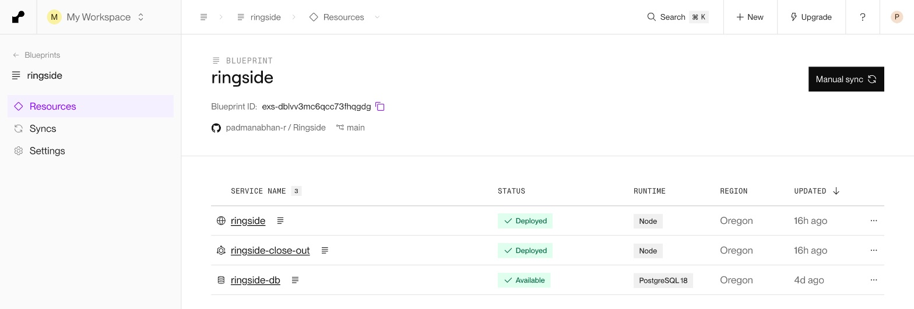
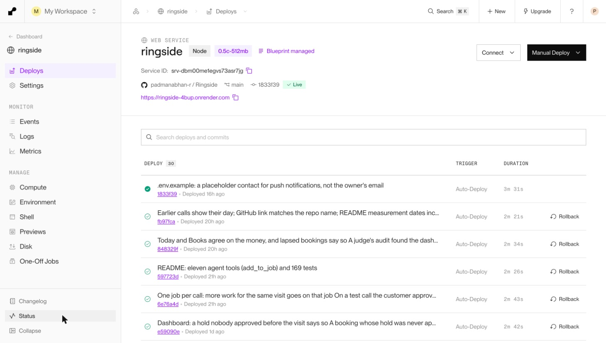
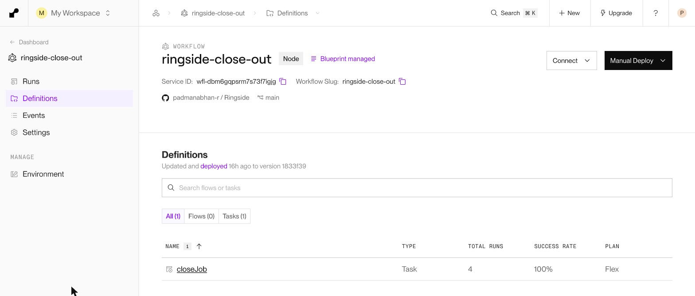
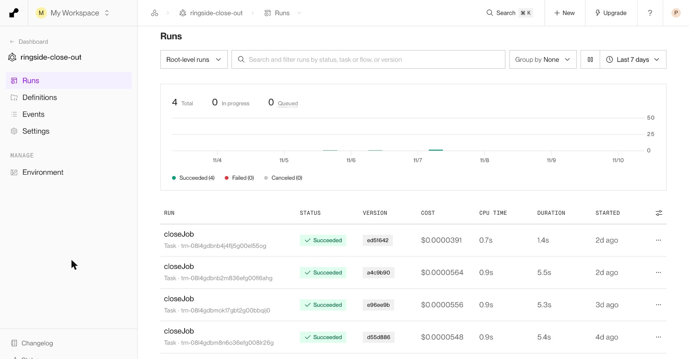
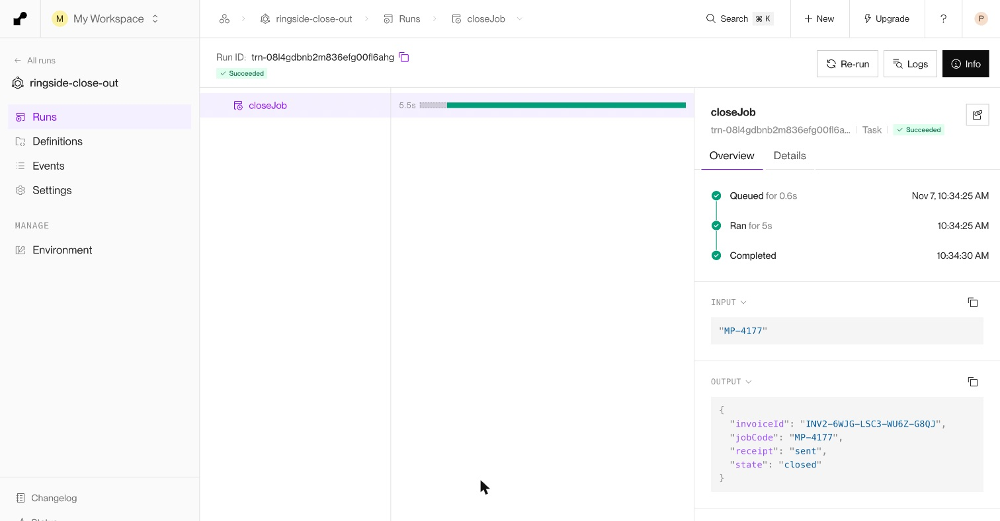
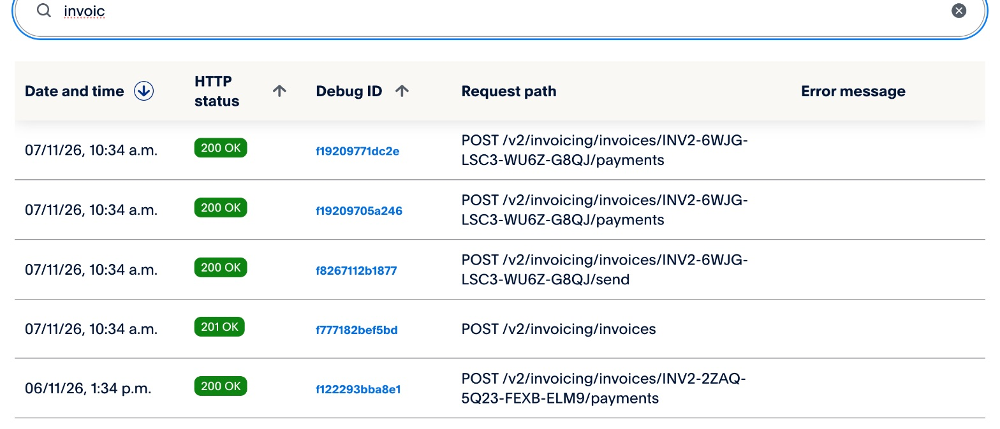

# Render in Ringside

[← Back to the README](../README.md#sponsor-tools-ag-grid-apimatic-and-render) · Sponsor pages:
[PayPal](paypal.md) · [AG Grid](ag-grid.md) · [APIMatic](apimatic.md) · **Render**

All of Ringside runs on Render, from one Blueprint: the always-on **web service** (the site, the voice agent's tools,
PayPal webhooks and the owner's dashboard), **Render Postgres**, and a **Render Workflows** service that closes out
each job once its money has been taken.

| Render product | What it does in Ringside | Config and code |
|---|---|---|
| **Blueprint** | Defines all three services, their plans, env vars and the private database link in one file | [`render.yaml`](../render.yaml) |
| **Web service** | Next.js app, auto-deployed on every push to `main`; migrations run as the pre-deploy command; health-checked | [`render.yaml`](../render.yaml), [`scripts/migrate.mjs`](../scripts/migrate.mjs), [`api/health`](../src/app/api/health/route.ts) |
| **Postgres 18** | Jobs, payments with their stored PayPal request IDs, calls and events; private network only | [`db/migrations/`](../db/migrations) |
| **Workflows** (`@renderinc/sdk` 1.3) | The `closeJob` task: the PayPal receipt invoice, the customer's email, then closing the job; retried by Render | [`workflows/close-out.ts`](../workflows/close-out.ts), [`src/lib/close-out.ts`](../src/lib/close-out.ts) |

---

## 1. One Blueprint, three services



The Blueprint is the whole deployment. Secrets are declared with `sync: false`, so they are entered once in the
dashboard and never stored in git. The workflow takes the PayPal and email credentials from the web service with
`fromService`, and both services reach Postgres over Render's private network (`ipAllowList: []`).

```yaml
# render.yaml (abridged)
services:
  - type: web
    name: ringside
    plan: 0.5c-512mb              # always on: a judge never waits for a cold start
    buildCommand: npm ci && npm run build
    preDeployCommand: npm run db:migrate
    healthCheckPath: /api/health
    autoDeployTrigger: commit

  - type: workflow
    name: ringside-close-out
    startCommand: node --experimental-transform-types --import ./workflows/register.mjs workflows/close-out.ts
    envVars:
      - key: PAYPAL_CLIENT_SECRET
        fromService: { type: web, name: ringside, envVarKey: PAYPAL_CLIENT_SECRET }

databases:
  - name: ringside-db
    postgresMajorVersion: "18"
    ipAllowList: []               # private network only
```

The web service redeploys on every push to `main`, with migrations applied before the new version takes traffic:



## 2. Render Workflows: the close-out

After the owner taps **Job done**, the app captures the real cost from the PayPal hold (that capture stays in the
web request, because it is the owner's action). Everything after the money is taken is handed to Render Workflows:

1. create the PayPal receipt invoice for exactly what was charged, send it, and record the payments against it;
2. email the customer their receipt;
3. move the job from completed to closed.

```ts
// workflows/close-out.ts
import { task, type TaskContext } from "@renderinc/sdk/workflows";
import { closeJob } from "../src/lib/close-out";

task(
  { name: "closeJob", retry: { maxRetries: 4, waitDurationMs: 5_000, backoffScaling: 2 }, timeoutSeconds: 300 },
  async function closeJobTask(_ctx: TaskContext, jobCode: string) {
    const result = await closeJob(jobCode);
    return { jobCode: result.jobCode, state: result.state, receipt: result.receipt.status, invoiceId: result.receipt.invoiceId };
  },
);
```

The web service starts a run through Render's API (`POST /v1/task-runs`) with an idempotency key, so a double click
within a minute becomes one run ([`src/lib/close-out.ts`](../src/lib/close-out.ts)). If Render refuses the run, or no
workflow key is set (local development), the same `closeJob` runs inline.

**Why a workflow:** PayPal can time out, and a process can die between creating an invoice and sending it. Render
retries a failed run with backoff, up to four times. `closeJob` is safe to rerun: every PayPal POST reuses its stored
`PayPal-Request-Id`, an existing invoice is found by its number rather than created again, and each step checks the
job's state first. A retry picks up where the last attempt stopped, and never invoices or emails twice.

### The task and its runs





| Run started (UTC) | Job | Duration | Result |
|---|---|---|---|
| 2026-11-05 13:58 | MP-8531 | 5.4 s | succeeded: invoice `INV2-VVFA-46VJ-WMX7-SX73` sent, job closed |
| 2026-11-06 08:04 | MP-8589 | 5.3 s | succeeded: invoice `INV2-2ZAQ-5Q23-FEXB-ELM9` sent, job closed |
| 2026-11-07 05:04 | **MP-4177**, the job in the demo video | 5.5 s | succeeded: invoice `INV2-6WJG-LSC3-WU6Z-G8QJ` sent, job closed |
| 2026-11-07 05:08 | MP-4177 again, four minutes later | 1.4 s | succeeded: the **same** invoice ID returned, nothing created twice |

Four runs in production, all succeeded and none failed. Each cost about $0.00005 of compute.

### One run, end to end

The run for job MP-4177: input is the job code, output is the PayPal invoice it sent and the job's final state.



The same invoice, in PayPal's log of the app's API calls at the same minute (10:34 IST): one invoice created, sent,
and the two payments (the job's capture and the extra work) recorded against it:



The second run for MP-4177, four minutes later, returned that same invoice ID in 1.4 s. PayPal's log shows no second
invoice: in production, a rerun didn't bill the customer twice.

---

## Why Render

A trades business's phone line can't sleep, so the web service is on an always-on instance. The money flow needs
its database to be private, and the after-payment work needs to survive a failure without double-billing anyone. All
three came from one Blueprint, deployed from git on every push.
